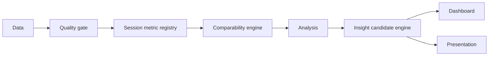

# dashboard-builder — marketing & growth KPI dashboards with a comparability engine underneath

[](https://github.com/ali-demirbas/dashboard-builder/actions/workflows/validate.yml)
[](LICENSE)


A Claude Code skill that turns fragmented marketing and business data into a decision system — KPI intelligence, cross-channel diagnosis, growth-bottleneck identification, unit-economics evaluation, and executive dashboard or presentation output.

Most marketing analysis fails on **comparing numbers that were never comparable**, not on arithmetic. The same metric name means different things across platforms, and a configuration change moves a number without any change in behavior:

- Google Ads dates conversions to the **click**, not the conversion. The last 30 days are permanently incomplete, and the same past date returns a different number when re-pulled weeks later.
- Play Console's "retained installers" measures whether the app **stayed installed**, not whether it opened. The same app can read ~70% D30 in Play and ~20% in Firebase, and both are correct.

The skill's primary job is catching that before it produces a wrong dashboard. The analysis and the visuals are secondary.

## Questions this skill helps answer

- Why is my CAC up — and is it actually acquisition, or a tracking/config change?
- Which channel is actually working, and what would it take to know for sure?
- These two platforms report different numbers for the same metric — which one do I trust, for what?
- Can I sum GA4 + Meta + Google Ads + Shopify revenue into one "Total Revenue"? (No — here's why, and what to use instead.)
- Build me an executive dashboard / growth-acquisition dashboard / SEO dashboard from this data.
- Turn this analysis into a presentation deck for stakeholders.
- Is my retention curve actually flat, or is the cohort just too small to tell?
- What's the real bottleneck in my funnel, sized in revenue, not just percentage drop-off?

## How it works



Every stage runs once, on the same data — the dashboard and the presentation are two renderings of one analysis, never two separate passes that can quietly disagree with each other.

- **Quality gate** — BLOCKER/WARNING/INFO severity, join-safety checks, anomaly triage before any conclusion.
- **Session metric registry** — every metric tagged EXACT/INFERRED/AMBIGUOUS so "Revenue" means one thing end to end, not a different column in three different sections.
- **Comparability engine** — classifies every side-by-side as DIRECT/NORMALIZABLE/CONDITIONAL/NOT_COMPARABLE before it's shown, with the specific counting mechanic named when it refuses.
- **Insight candidate engine** — an 8-question rule-based gate (not a numeric score) deciding what's real, material, and actionable enough to surface — SUPPRESS is the point, not a side effect.

## Install

In Claude Code:

```
/plugin marketplace add ali-demirbas/dashboard-builder
/plugin install dashboard-builder@dashboard-builder
```

Or clone and add as a local plugin:

```bash
git clone https://github.com/ali-demirbas/dashboard-builder.git
claude --plugin-dir ./dashboard-builder
```

Or install with the [skills CLI](https://skills.sh):

```bash
npx skills add ali-demirbas/dashboard-builder --all
```

## Usage

| You say | What happens |
|---|---|
| "Analyze this data" (+ files) | Ingestion summary, data-quality findings, 5–10 prioritized observations — never jumps straight to a dashboard |
| "Build a dashboard" | Offers only the templates your actual data supports (of 11), then renders a self-contained HTML dashboard |
| "Make me a deck / presentation" | Same underlying analysis, rendered as a PPTX deck — gated tighter than the dashboard (only CRITICAL/HIGH findings by default) |
| "Why is my CAC up" / "which channel is working" | Diagnosis-first: hypothesis elimination, checks tracking/config changes before a demand-side story, names the experiment that would actually settle causation |
| "These numbers don't match" | Cross-source reconciliation — the seven-point checklist, what each source is actually valid for, no picking a winner |
| "Is this dashboard/report right?" (+ an existing plan or output) | Runs the same data-quality and comparability checks against what you already have |

## What's inside

```
skills/dashboard-builder/
  SKILL.md                            workflow, operating principles, non-negotiable rules
  references/
    data-quality-gate.md              BLOCKER/WARNING/INFO severity, check sequence, anomaly triage
    comparability-rules.md            when two numbers must not be compared, and what to say instead
    kpi-framework.md                  formulas, definitional variants, action triggers, sourced benchmarks
    analysis-playbook.md              ingestion, time-series, funnel, channel, CRM, executive diagnosis
    dashboard-blueprints.md           the 11-template catalog, design spec, rendering mechanism
    presentation-blueprints.md        the presentation/deck output format — layouts, content rules, PPTX rendering

research/
  search-playbook.md                  how to search the web for KPI *relationships* (vs definitions)
  raw/                                vendor-sourced metric definitions, every entry with a source URL
    google-stack-metrics.md           GA4, Google Ads, Play Console, Firebase, Search Console
    mmp-attribution-metrics.md        Adjust, AppsFlyer, Branch, Singular, SKAdNetwork/AdAttributionKit
    crm-lifecycle-metrics.md          Braze, Klaviyo, Iterable, Insider, D·engage, MPP, deliverability
    paid-media-metrics.md             Meta, TikTok, LinkedIn, IAB/MRC standards, platform incrementality
    unit-economics-metrics.md         CAC, LTV/CLV, payback, retention, churn, NRR, MER, iROAS
    dbt-data-quality-tests.md         dbt-utils and dbt-expectations generic tests for marketing data

scripts/                              repo validators (frontmatter, internal links, references-table/disk sync, shipped-content injection scan)
tests/                                unit tests for the validator scripts
evals/                                pointer to TEST-SUITE-regression-benchmark.md's golden-test cases

dashboard-builder-consolidated.md     generated release artifact — see CLAUDE.md, don't edit directly
MAINTENANCE-LEDGER.md                 pass/module tracking for maintenance and audits
```

<details>
<summary><b>The 11 dashboard templates</b></summary>

Two tiers — Tier 1 for a blended, multi-domain dataset; Tier 2 for one specific data shape. Only the templates your actual data supports are ever offered.

| Template | Question it answers |
|---|---|
| A — Executive Summary | Is growth healthy, efficient and profitable? |
| B — Growth & Acquisition | Where are we acquiring users and how efficiently? |
| C — Lifecycle & CRM | How effectively are we activating, retaining and monetizing existing users? |
| D — All-in-One Growth Tower | What is the complete growth system telling us? |
| E — E-commerce & Revenue | Are we selling well, and to whom? |
| F — SaaS / Subscription | Is the subscription base healthy and growing sustainably? |
| G — Mobile App & Store | How is the app performing in the stores, and are people sticking with it? |
| H — Web Analytics | How are visitors behaving on the site, independent of what brought them there? |
| I — Single-Channel Deep Dive | How is this one channel actually performing, campaign by campaign? |
| J — Cross-Source Reconciliation | Why don't these two platforms agree, and which one should I trust for what? |
| K — SEO & Organic Search | Is organic search actually bringing people in, and for what? |

Template selection runs three filters in order: data shape (what's structurally possible) → business question (what you're actually trying to decide) → available evidence (what the data can answer at a defensible confidence level) — not a manually-declared vertical.

</details>

<details>
<summary><b>What makes a number safe to compare</b></summary>

Before any two figures are placed side by side, they're classified into one of four states — never silently averaged or picked between:

| State | Meaning |
|---|---|
| **DIRECT** | Same counting unit, denominator, attribution window/model, date basis — compare as-is |
| **NORMALIZABLE** | A pure unit/scale conversion (e.g. MER as spend÷revenue vs. revenue÷spend) — convert, then compare |
| **CONDITIONAL** | Both valid, answering different questions (Adjust installs vs. GA4 new users) — state what each is valid for, never rank or net them |
| **NOT_COMPARABLE** | A named hard block applies and no normalization exists — refuse, name the specific counting mechanic, name what would make it comparable |

Every hard block traces to a vendor's own documentation or a peer-reviewed paper — not a general "these might differ" caveat.

</details>

## Development

```bash
bash scripts/validate.sh              # frontmatter, internal links, references table, plugin manifest, shipped-content scan, staleness
python3 -m unittest discover -s tests -v
```

Both run in CI (`.github/workflows/validate.yml`) on every PR. See [`CONTRIBUTING.md`](CONTRIBUTING.md) for the editing workflow and [`CLAUDE.md`](CLAUDE.md) for the repo's binding maintenance rules (source-of-truth discipline, sourcing standard, no real account data in the repo).

## Sourcing standard

Every definition, formula and benchmark in `research/raw/` was verified against a page fetched at research time and carries its source URL. Items that could not be verified are listed as omitted rather than filled in from memory. Where sources genuinely disagree — and they often do — **both positions are recorded as a conflict rather than resolved silently.**

Benchmarks always carry their sample and the caveat the publisher attached. Several widely repeated industry numbers turned out to be misattributed or self-contradictory; those are flagged in place.

## Status

Skill content is complete and internally consistent across 21 development passes. Execution-tested against 4 synthetic scenarios (real subagents, cross-verified arithmetic) and one real 7-file GA4 export from a live property — all passed. 4 of 50 `TEST-SUITE-regression-benchmark.md` golden-test cases automated; the remainder is a manual checklist pending automation. Repo scaffolding (CI, validators, tests) is live and green.

## Prior art

The structural patterns here draw on [aaron-he-zhu/aaron-marketing-skills](https://github.com/aaron-he-zhu/aaron-marketing-skills) (Apache-2.0) for the KPI-matrix format with action triggers and the proxy-vs-outcome measurement model, and on [ai-analyst-lab/ai-analyst](https://github.com/ai-analyst-lab/ai-analyst) (MIT) for the metric-spec template and the severity-graded data-quality gate.
